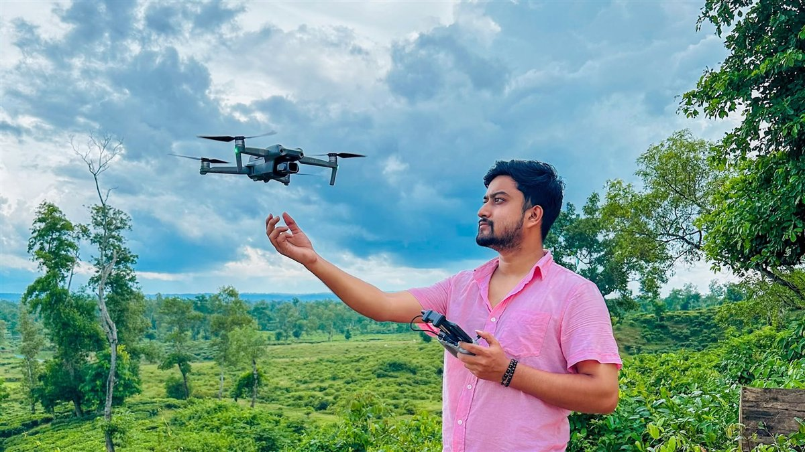

<div align="center">

# PRISM PULSE

### *Light in motion. Stories in focus.*

**Cinematography · Fine-Art Photography · Licensed Aerial Visuals — Dhaka, Bangladesh**

[](https://prism-pulse.pages.dev/)
[](https://react.dev/)
[](https://www.typescriptlang.org/)
[](https://tailwindcss.com/)
[](https://vite.dev/)

<br />

<a href="https://prism-pulse.pages.dev/">
  
</a>

</div>

---

## ✨ Overview

**Prism Pulse** is the official digital portfolio and visual archive of **Mubarak** — a Dhaka-based cinematographer, fine-art photographer, and aerial drone creator operating across Bangladesh.

Designed with an **editorial dark-cinema aesthetic**, the site pairs gallery-grade typography (*Cormorant Garamond*, *Plus Jakarta Sans*, and *JetBrains Mono*) with an ultra-lightweight architecture where all high-resolution photography is delivered via **Cloudinary CDN (`f_auto,q_auto`)** and 4K films stream on-demand.

- 🌐 **Live Portfolio:** [https://prism-pulse.pages.dev/](https://prism-pulse.pages.dev/)
- 🎬 **YouTube Channel:** [@PrismPulse_art](https://www.youtube.com/@PrismPulse_art)
- 📸 **Instagram:** [@prism__pulse](https://www.instagram.com/prism__pulse)
- 📘 **Facebook:** [Prism Pulse](https://www.facebook.com/profile.php?id=61581682466136)

---

## 🎯 Key Features & Architecture

- **Editorial Cinema Hero:** Widescreen (`21:9`) showreel stage with instant on-demand 4K YouTube No-Cookie modal playback.
- **Pexels-Inspired Masonry Gallery (`Selected Works`):** 3-column natural-aspect-ratio masonry layout showcasing **22 original photographs** and **9 films** with category filtering (`All`, `Photography`, `Films`, `Drone`, `Commercial`) and a keyboard-accessible darkroom lightbox.
- **Motion & Films Theater (`FilmsShowcase`):** Dedicated widescreen showcase featuring live concert cinematography (*Shironamhin*), rural heritage poems (*Gram Bangla*), aerial coastal studies (*Cox's Bazar*, *Sreemangal*, *Mohonpur Rubber Dam*), and runway fashion coverage.
- **Interactive Expanding Cinema Accordion (`Services`):** 4-panel horizontal interactive showcase highlighting *Cinematography & Films*, *Editorial & Portrait Photography*, *Aerial & Drone Visuals*, and *Brand Stories & Commercial* with direct WhatsApp project inquiry links.
- **Cloudinary Global CDN Optimization:** All 24 high-resolution visual assets are served via Cloudinary with automatic format negotiation (`AVIF` / `WebP` via `f_auto,q_auto`), keeping the entire production bundle under **~140 KB gzipped**.
- **Comprehensive Technical SEO:** Configured with canonical URLs, Open Graph (`1200×675`) & Twitter summary cards, `robots.txt`, `sitemap.xml`, and `ProfessionalService` JSON-LD structured data.

---

## 📁 Project Structure

```text
prism-pulse/
├── public/
│   ├── favicon.png            # High-resolution brand icon
│   ├── favicon.svg            # Vector favicon
│   ├── hero-thum.jpg          # 1200×675 Open Graph & social share cover
│   ├── Prism-Pluse.png        # Brand mark for structured data
│   ├── robots.txt             # Search engine crawler directives
│   └── sitemap.xml            # XML sitemap for indexing
├── src/
│   ├── assets/
│   │   └── Prism-Pluse.png    # Header navigation brand emblem
│   ├── components/
│   │   ├── Button.tsx         # Reusable accessible button component
│   │   ├── Container.tsx      # Max-width responsive layout container
│   │   ├── Header.tsx         # Floating glass pill navigation bar & mobile drawer
│   │   ├── ImageLightbox.tsx  # Fullscreen keyboard-navigable photo lightbox
│   │   ├── SocialIcons.tsx    # Custom SVG social brand icons
│   │   ├── VideoModal.tsx     # On-demand 16:9 cinema video player modal
│   │   └── WhatsAppPopup.tsx  # Minimal floating WhatsApp quick-chat trigger
│   ├── data/
│   │   ├── projects.ts        # 31 curated photography & film entries + Showreel config
│   │   └── siteConfig.ts      # Centralized brand identity, services & contact config
│   ├── sections/
│   │   ├── Hero.tsx           # Widescreen showreel hero section
│   │   ├── SelectedWorks.tsx  # 3-column masonry archive with category filters
│   │   ├── FilmsShowcase.tsx  # Featured showreel & motion picture showcase
│   │   ├── Services.tsx       # 4-panel interactive horizontal accordion
│   │   ├── About.tsx          # Stacked viewfinder portrait & creator identity
│   │   ├── Contact.tsx        # Full-bleed aerial contact portal & 1-click email copy
│   │   └── index.ts           # Section barrel exports
│   ├── App.tsx                # Root application composition
│   ├── index.css              # Tailwind CSS v4 theme tokens & custom utilities
│   └── main.tsx               # React 19 DOM entry point
├── index.html                 # HTML5 entry with SEO meta tags & JSON-LD schema
├── package.json               # Scripts & dependencies
├── tsconfig.json              # TypeScript configuration
└── vite.config.ts             # Vite 8 bundler configuration
```

---

## 🚀 Getting Started

### Prerequisites
- **Node.js** `20.x` or higher
- **npm** `10.x` or higher

### Installation & Local Development

```bash
# 1. Clone the repository
git clone https://github.com/assaduzzaman-10/prism-pulse.git
cd prism-pulse

# 2. Install dependencies
npm install

# 3. Start the Vite development server
npm run dev
```

Open [http://localhost:5173](http://localhost:5173) in your browser.

### Available Scripts

| Command | Description |
| :--- | :--- |
| `npm run dev` | Starts the local Vite development server with HMR |
| `npm run lint` | Runs `oxlint` across all TypeScript & React files |
| `npm run build` | Type-checks (`tsc -b`) and builds production assets into `dist/` |
| `npm run preview` | Locally previews the production build from `dist/` |

---

## 🛠️ Updating Portfolio Content

All portfolio media and studio details are managed through two centralized data modules:

1. **Portfolio Works & Videos (`src/data/projects.ts`)**
   - Add or reorder photography and film entries in the `PROJECTS` array.
   - Update the main hero showreel in `SHOWREEL_PROJECT`.
   - Images use Cloudinary `f_auto,q_auto` CDN URLs (`https://res.cloudinary.com/npp4zjhc/image/upload/f_auto,q_auto/...`).
2. **Studio Identity, Services & Contact (`src/data/siteConfig.ts`)**
   - Update WhatsApp number, email, social links, creator portrait, and the 4 service offerings in `siteConfig`.

---

## 🌐 Deployment (Cloudflare Pages)

This project is pre-configured for zero-config deployment on **Cloudflare Pages**:

- **Build command:** `npm run build`
- **Build output directory:** `dist`
- **Node.js version:** `20`

---

## 📄 License

© **PRISM PULSE** · Created by Mubarak (Dhaka, Bangladesh). All rights reserved.
